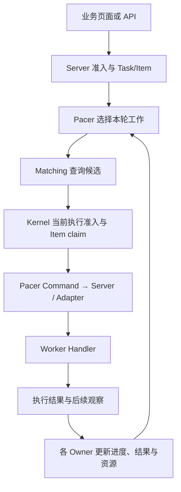

# 架构与关键概念

Status: current human architecture projection.

XA Mass 管理两条相连的状态线：一条是 Task/Item 的工作进度，另一条是 Worker 的资源、
属性和执行资格。Matching 提供候选，Execution 取得执行权并投递，Convergence 将
执行反馈与外部观察写回各自 Owner，供下一轮决策使用。

这里解释如何理解系统；完整机制定义和代码指针仍由
[调度主线](../kernel/scheduling-overview.md)及[各 Owner](../README.md#owner-documents)维护。

## 先认识运行对象

| 对象 | 作用 | 不应混同 |
| --- | --- | --- |
| Task / Item | 一份工作配置和其中的执行项；有进度、重试、终态与结果 | 多个业务种子可能属于一个 Item |
| Worker / Group | 执行端身份及其能力/资源归属 | Group catalog 不是实际 Handler 清单 |
| Event / Handler | 完整事件名和 Host 中处理它的本地代码 | Report 事件不是可调用能力 |
| Project | Server 的业务归属、Group 关联和准入范围 | 不拥有独立调度器、Pool 库存或 Worker 配额 |
| Properties | 接受的 Worker/Platform 事实，供规则解释 | 连接状态、执行资格与业务事实分别成立 |
| Pool / query | 有限候选库存及对 Item 输入的查询解释 | 候选不是已预约的执行权 |
| Score / lease | Kernel Owner 控制的调度坐标和执行 fence | 外部模块不得自行解码或计算坐标 |

## 工作如何执行

供给与 Item 查询是独立路径。Task 可以声明某 Pool 的补充目标，
Item 再通过具名函数消费候选；按 Worker ID 或号码的直接查询可以不使用 Pool。
两条路径最终仍需 Kernel 检查当前 Worker 与 Item，并写入精确执行资格。

图中的箭头不是一次原子事务。成功执行、Result 保存、Item 终态和 Worker 释放可能
分别发生；其中某一步失败不意味着其他步骤自动回滚。
调度 fence 也不能停止已经准入的 Handler，或保证外部业务副作用 exactly-once。

## 谁可以决定和写入

| Owner | 责任 |
| --- | --- |
| Kernel | 机械调度状态、Task/Item/Worker 资源、Score、精确 claim 和 Redis 操作 |
| Pacer | Kernel 上的生产策略、轮次、供给、重试恢复及生命周期 |
| Matching | Properties、资格解释、Pool/index 与有界候选证据 |
| Server | API 准入、身份与 Project、路由关联、业务用例和资源装配 |
| Transport | 已决定 Command 的投递、连接及 Worker 本地执行 |
| Scenario / Host / Frontend | 业务解释、能力和设备状态、观察与用户交互 |

Server 和 Transport 不选择替代 Worker，不接管租约、Item claim 或任务最终收尾。
未来的授权架构迁移可以调整边界，但不能把权责变化藏在普通清理中。

## 三种观察要分别看

连接告诉你 Adapter 当前看到什么；Properties 告诉你已接受哪些事实；
调度状态告诉你当前是否能尝试取得执行资格。已连接 Worker 仍可能占用、恢复中，
或不符合某个业务查询。Pool 内候选也可能在最终执行准入时过期。

Convergence 包括执行结果、释放和超时等内部反馈，也包括连接、属性、Probe 等外部观察。
它是行为视角，不保证每条反馈可靠交付或所有状态最终自动修复。
业务使用投影可能有损，不能把窗口观察计数解释为严格预留配额。

## Direct Call 与任务不同

Direct Call 由调用方指定目标，通过现有 Adapter/Worker 执行并等待一次关联回复。
它不创建 Item，不取得 Kernel 调度租约，不提供任务重试或持久结果查询。
调试成功只能说明这次调用取得回复，不能证明 Worker 可调度。

## 运行拓扑与规模

Boot 在一个 Java Server 进程中装配 API、Kernel/Pacer、Matching、Adapter 和启用的
Scenario；Redis 外置，Worker Host 独立。每个 Redis scope 只允许一个 Server 启用 Pacer。
源码 launcher 可以同时管理本次 Server、Java Host 与选定 Android App，
但进程启动不改变这些模块的权限。

当前模型是少量有界活跃 Task、每 Task 多个 Item、有限 Group 内大量 Worker。
大量活跃 Task/Group、多租户隔离、分片或分布式调度需要另外论证；
增加线程不会自然分散 Redis Owner 热 key。
可用的规模证据与口径见[实测能力](capabilities.md)，各证明的边界见[验证](verification.md)。
