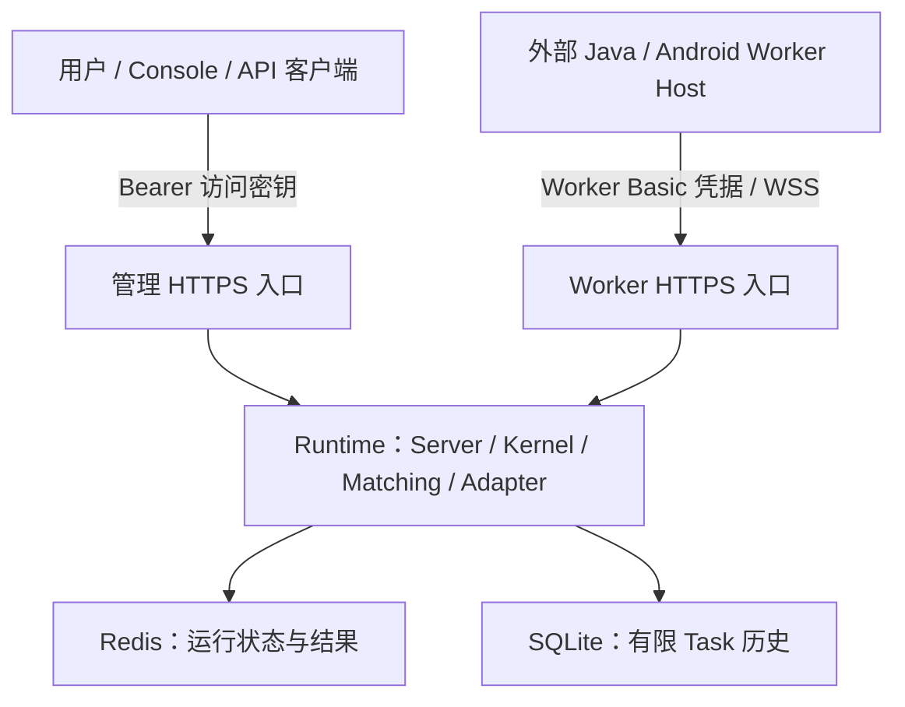

# 接管、部署与运行

Status: current deployment navigation and operating guide.

已有环境从[接管入口](#release-preview)开始；本地体验使用[源码启动](#从源码启动)，
新安装使用[发行包启动](#从发行包启动)。本页说明操作路线，实际安装与健康状态需在授权的环境任务中核对。

## 认识运行环境



Server 与 Worker Host 独立运行；Redis 由环境提供，Runtime 不会启动 Worker。
同一 Redis scope 只允许一个 Server 启用 Pacer。网关、Runtime 与 Host 的进程恢复各有自己的服务管理。

| 形态 | 用途 | 操作前提 |
| --- | --- | --- |
| `consumer` profile | Batch Checks／Messages 与外部 Host | 两业务默认启用，需有效外部业务及资源配置；不装配 SMS，不自动启动 Worker |
| `default` profile | 普通平台 | 不预置 Adapter、Group 或业务 Worker |
| `preview` profile | 三场景本地体验 | 源码启动器可管理 Server、Adapter 和 Java Simulator |
| Release Preview | 按 Release 推进的长期真实环境 | 是环境用途，不是 profile；消费发布 Runtime 与外部 Worker，不要求 Preview ZIP |

配置输入和只启用部分业务的方法见[配置归属](configuration.md)。

## Release Preview

GCP 是长期 Release Preview 环境，用于固定版本的真实部署与小规模使用验收，不承担客户生产 SLA。
日常代码任务在本地与 CI 验证后以 PR 交付；明确的环境任务才包含部署、现场诊断或公网验收。
GitHub CI 负责构建与 proof，主机消费已发布制品，不构建源码或重复完整 CI。

### 接管现有环境

1. **核对操作是否正在进行。** 读取目标主机的操作日志。有未结束的改动时先停止并确认负责人，避免两个操作者同时变更。
2. **核对环境身份。** 将安装版本、完整 commit、制品指纹、配置位置与实际服务启动参数对应起来；先确认 scope 和数据目录，再处理异常。
3. **确认任务目标。** 日常使用、排障、配置变更、Release 升级各自选择下方路线。只读记录不代表已检查实时健康。

| 权威记录 | 用途 |
| --- | --- |
| GCP `/etc/xa-mass/release.json` | 已安装 Runtime 版本、完整提交、来源与制品指纹 |
| GCP `/etc/xa-mass/deployment.json` | 配置坐标与指纹、变更组件来源、已完成／待补验收 |
| GCP `/etc/xa-mass/OPERATIONS.txt`、`operations.log` | 服务与日志入口、凭据位置、实际操作约定、是否有未结束操作 |
| Ali `/var/log/xa-mass-consumer/OPERATIONS.txt`、`operations.log` | 常驻 Host 安装、服务、当前问题和操作记录 |
| Ali `/var/lib/xa-mass-performance/runs/<RunID>/` | 原 campaign 的私有收据、进程与结果，供接回同一 Run |

本地 `build/deployments` 只是副本，不能成为新 checkout 的唯一交接来源。
仓库不复制完整线上状态或凭据。读取运维说明不需要读取或输出其中指向的秘密文件。

### 四种版本分别核对

| 组件 | 从哪里确认 | 对其他组件的影响 |
| --- | --- | --- |
| Runtime | `release.json` 与实际安装、`INSTALLED_RELEASE_TAG/COMMIT` | 发布新版本不会自动升级主机 |
| 常驻 Worker Host | Host 安装记录、配置与 inventory | 不跟随 Actions 或 Runtime 自动替换 |
| 按需 Performance kit | `PERFORMANCE_KIT_RELEASE_TAG/COMMIT` 与本轮 manifest | 与目标 Runtime 分别固定，不表示任意版本兼容 |
| 入口 renderer | `deployment.json` 最近一次入口变更的 Release／commit／SHA、生成配置指纹 | 单独更新 renderer 不应把 Runtime 重标为其版本 |

按实际已生效记录选择 renderer；不要从旧安装目录或历史排查段落推定当前版本。
具体兼容与数据处理采用[目标 Release 契约](../../../distribution/server/RELEASE-4.6.md)。
已结束升级和测量的摘要见[带日期的证据](../capabilities.md#external-public-closeout)，不是实时状态表。

### 访问与凭据

以下是脱敏入口；环境任务开始时仍需与主机记录核对：

| 入口 | 地址或位置 |
| --- | --- |
| 管理网页/API | `https://staging.xamass.net` |
| Worker Runtime | `https://workers-staging.xamass.net` |
| 授权后的 SSH 管理 | `root@136.85.101.232`，使用已有私有凭据 |
| Ali consumer | `release-preview-load` Environment 的 `CONSUMER_SSH_HOST`；campaign 账户为 `xa-mass-performance`，管理入口以私有运维记录为准 |

管理员和普通用户在 Console 输入自己的访问密钥，程序调用传 `Authorization: Bearer <access key>`。
Runtime 用户目录决定角色与 Project 授权。Worker 使用独立的共享 Basic 网关凭据，
它不提供用户管理权限，也不隔离单个 Worker 身份。内置 `xak_dev_*` 密钥仅供本地体验。

用户、角色、Project 授权与密钥由 Console／API 管理；运行中用户文件只由 Server 写入。
首次管理员初始化、文件权限与密钥保管见[公网接入](#公网接入)和
[用户目录 Owner](../../../server_jvm/README.md#user-directory-and-access-keys)。

## 日常使用与观察

1. 登录被授权的管理入口，核对当前用户及 Project。页面缺少业务时先查生效 Catalog 和 Scenario 装配。
2. 按 [Batch Checks](../usage/batch-checks.md)、[Messages](../usage/messages.md)或[任务工作台](../usage/workbench.md)操作。
   选择已安装的能力；用少量已知答案核对输入、费用（如适用）、执行结果和导出。
3. 保留原 Task ID、messageId 和 requestId。未确认操作先核对／继续原操作，不另建请求掩盖未知结果。
4. 结果已释放时使用显式 Storage 历史入口；RPC 消费与回收遵循另一套规则，见[数据归属](configuration.md)。

| 观察层 | 观察入口 | 可以确认什么 |
| --- | --- | --- |
| 服务 | 主机服务／日志、`/actuator/health/readiness` | 服务达到就绪条件，不保证有可执行 Worker |
| 连接 | Runtime Workers 的已知 Group／Worker 详情 | 当前网络投影；有界列表不能证明全量在线 |
| 能力与资格 | 实际 `platform.worker.events.snapshot`、Group 资源和 Properties | 安装了什么、能否满足业务选择；连接与调度资格不同 |
| 业务闭环 | 已知 Task／messageId 的状态、结果及导出 | 本次实际工作与答案；不能推广为整个环境长期健康 |

长期 Host 负责正常接任务，systemd 负责进程恢复；常驻 Worker 不持有 operator 密钥，
不定时提交验收任务。小规模检查使用独立消费者的一轮
[finite round](../../../distribution/worker-simulator/README.md)，或目标版本指定的业务步骤。

## 排障与恢复

先从[按现象排障](troubleshooting.md)定位。涉及接入冷却时，分别核对冷却记录、
网络连接、调度 PAUSE 与 Pool 资格，不能用其中一个状态推定另外三个。

维护重启后，Host 进程存活不保证 Worker 已恢复。先读取实际 runtime 状态与已知身份：
若 desired RUNNING 而 runtime STOPPED，按目标版本说明使用现有可信 Lab 的显式 start，
再独立确认原身份恢复；不要生成新 inventory、修改重试预算或把手工恢复记为自动恢复。
原始错误、未知请求及未确认 cleanup 均保留，交给开发者的证据格式见排障页。

## 变更与验收

保存配置、重启生效和旧 Task 快照分别核对，详见[配置说明](configuration.md)。
部署前明确目标 Release、要改的组件、数据／scope 处理和验收范围，读取当前未结束操作。
版本特有步骤随 Release 审查，主机执行时不临场设计兼容层或数据迁移。

替换外部配置文件时保留属主、属组和权限，并在重启前以实际服务账号确认可读；
仅复制时间戳和 mode 不会保留属主／属组。维护中启动失败的 journal 和回执继续保留；
若修复后需要解除 systemd 启动频率保护，应单独记明原失败次数与恢复动作。

主机改动遵守既有单操作者记录：开始、结束各记一行，精确格式以 `OPERATIONS.txt` 为准。
准备一份临时恢复点，覆盖本次要求的配置、用户文件、入口、Redis 和 SQLite；
数据库一致性及恢复条件按目标 Release。二进制回退不能恢复已经删除的数据。
不得自动清 Redis、重放未知业务请求或维护本次范围之外的旧 scope。

升级只消费不可变制品并核对指纹；不覆盖正在运行的 JAR／网页，不同时启用两个同 scope Pacer。
验收至少核对身份／配置、服务就绪、入口认证、一次经外部 Worker 的有限任务和结果。
本次涉及 Console 行为时再做对应网页交互。记录通过、失败、未覆盖与待验收，不用 HTTP 成功代替网页操作。
完成验收后按既有规则删除旧安装和本次临时恢复点，关闭操作记录；GitHub Release 保留制品归档。

GCP `/docs/` 随安装制品发布。更新仓库或主机外置说明不会更新包内网页，文档随下次正常 Release 交付。

### RPC 终态数据保留

包含此能力的版本默认关闭 RPC 子开关；启用需同时开启既有 retention 总开关。
目标 Release 决定启用值和验收步骤，当前配置字段见
[Server RPC retention](../../../server_jvm/README.md#rpc-terminal-item-retention)。

默认时间配置为终态 1h 后释放输入、24h 后清理输入／Result／Score，包含尚未消费的 Result。
只处理有合法 raw 归属、OPEN 且观察为 parked 的 RPC Task；ACTIVE、有限 Task、SMS 和其他 scope 不适用。
维护受预算与空闲机会限制，不是到点立即删除，也不生成 SQLite 历史。
旧调用过期后不自动重放，新业务使用新 messageId；停用只停止未来删除，不能恢复数据。
观察扫描、匹配、删除、跳过与错误，以及实际内存，不以 key 数或 RSS 必须归零判断通过。

## 从源码启动

第一次本地体验见[快速启动](../quick-start.md)。默认 Preview 使用临时 scope，正常退出会删除
该 scope 的任务、结果、积分及本次私有历史。需要跨重启保留时，从首次启动指定目录和 scope：

```powershell
python run_local_runtime.py --profile preview --work-dir .runtime/guide-preview --redis-scope guide_preview
```

复用目录与 scope 不等于永久保留，Task 自身到期规则仍生效。仅指定 `--work-dir` 不关闭临时 scope 清理。
Redis、端口、工具与全部参数由[源码启动 Owner](../../../distribution/server/README.md#source-launch)维护。

## 从发行包启动

| 交付物 | 如何使用 |
| --- | --- |
| Runtime ZIP | Server、Adapter 与前端；按 manifest 取得 JAR／入口，提供 Redis 与宿主配置，见 [Runtime archive](../../../distribution/server/README.md#runtime-archive) |
| Preview ZIP | 额外包含独立 Java Host 与有限启动器；新目录安装 requirements，运行 `python run_preview.py`，不使用源码 `--build`，见 [Preview delivery](../../../distribution/server/PREVIEW.md#archive-delivery) |
| Worker Simulator kit | 外部 Java Host 与独立有限验收命令，固定发布版本；见 [kit](../../../distribution/worker-simulator/README.md) |

需要持久 Preview 时同样传固定 scope 并复用 work directory。
真实 consumer 使用[两业务配置样例](../../../distribution/server/src/main/dist/examples/consumer-business/README.md)；
只启用一种业务或普通平台时显式关闭不需要的 Scenario。

### 公网接入

用 Runtime ZIP 的[staging ingress 示例](../../../distribution/server/src/main/dist/examples/staging-ingress/README.md)
准备管理和 Worker 两个 HTTPS 入口。内部 Adapter API、Redis 不公开，Runtime／Adapter 继续监听本机。
先准备证书、私有 Worker 凭据、用户文件和宿主 Group／Pool 配置，按所选 renderer 生成并校验入口配置。

consumer 必须显式设置 `xa.mass.users.seed`，指向自己的可写用户文件；运行中由 Server 独占写入。
全新环境的首个管理员在停止 Server 时初始化，密钥只私下交付，存储 SHA256 而不把明文写进仓库／日志。
具体文件格式和签发流程见[用户目录](../../../server_jvm/README.md#user-directory-and-access-keys)。

Java Host 配置 HTTPS `runtimeApiBaseUrl` 和私有 `gatewayCredentialFile`，后者相对主配置文件解析；
读取失败不回退匿名连接，更换凭据需明确重启 Host。使用独立 kit，不用本地 Server 启动器接远端。
Android 沿用[静态构建、安装和私有凭据注入](../../../xa-android/README.md#public-runtime-connection)。
SDK 凭据只发送给认可的 HTTPS/WSS authority；公网连接不依赖 SSH 隧道或 ADB reverse。

清除用户密钥会拒绝其下一次 API 请求；删除 Worker 网关凭据主要拒绝新接入，
撤销已有连接还需实际关闭连接，不能把 Nginx reload 当作已断连。

### 外网观测入口

按需测量使用现有 [External Performance](../../../integrations/worker-call-performance/README.md#external-actions-execution)，
手动与限期日程共用同一 consumer；按 Run ID 接回原任务，不因未知状态重新提交 workload。
已知窗口 `external-10k-20261120` 安排北京时间 2026-11-20 至 11-26 每日 05:30，
以[窗口配置](../../../.github/external-performance-observation.json)和
[日期准入规则](../../../integrations/worker-call-performance/README.md#seven-date-external-observation)为准。
七个日期不保证七次成功；跨日、漏触发和冲突不补跑，配置就绪不代表已运行。
日常部署不附加这项测量；源码 Nightly、常驻 Host 各自保持独立。

扩大连接规模时，还需按 [Boot Report 预算](../../../server_boot_jvm/README.md#report-ingress-budget)
核对集中启动／退出的证据入口。consumer 默认的 1,000 条每 lane 预算不能据此视为
10k 同时退出的预算。配置生效后除核对物理连接撤销，还应独立确认该轮已知身份的
调度证据收敛，并记录队列拒绝／提交错误；仅 case 通过或清理时网络投影为空不替代这项核对。
受控维护保留常驻 Host 的 inventory 与身份；若 SDK 已耗尽原有重连预算，使用既有
Lab 显式恢复，并分别记录自动重连和人工恢复。

旧公网 Loaded 调查已结束，结果见[能力摘要](../capabilities.md#external-public-closeout)。
本地 Loaded Nightly 和包内交付检查保留原职责，不从旧记录重新启动公网调查。

## 停止与保留

真实环境按其服务管理与操作记录停止指定组件，先明确哪些数据和身份需要保留。
本地启动器使用 Ctrl+C 并等待自有进程退出、ADB 映射恢复；不按进程名批量结束其他服务。
异常退出依据本次运行目录中的 PID、端口与 scope 核对残留。

配置、Worker inventory、Redis 运行数据和 SQLite 历史各有生命周期，见
[数据目录](../../../distribution/server/README.md#finite-task-history)。
只清理明确拥有的临时 `test_*` scope；正常运维不以清空数据库或更换请求 ID 处理故障。
